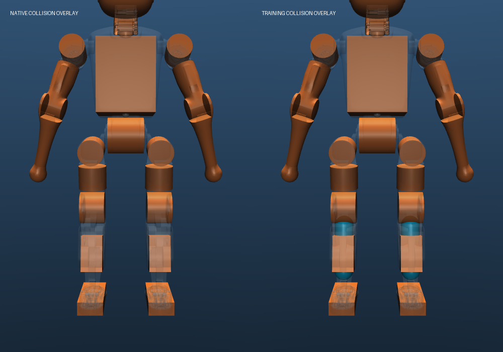

# I2 最小训练模型：小腿碰撞覆盖

本轮完成独立训练模型 `i2_shank_capsules_v1`，以及原生/训练模型的配对验证。仅补充左右小腿的两个保守碰撞体，已验证真实接触力和球速变化；没有训练策略，也没有完成全身碰撞覆盖或实物参数标定。

实现：[training_model.py](../k1_goalkeeper/training_model.py)。正式输出位于 [run_02](../reports/training_model_validation/run_02/results.json)，包括编译后的 `native.xml`、`training.xml`、验证协议和逐物理步轨迹。原 I1 默认构造仍使用原生模型，需要显式传入训练模型。

## 几何修改与依据

| 项目 | 内容 |
|---|---|
| 新增部位 | `left_knee_pitch_link`、`right_knee_pitch_link` |
| 碰撞名称 | `i2_left_shank`、`i2_right_shank` |
| 形状 | capsule，半径 0.027 m |
| 局部中心线端点 | `(0.007, 0, -0.05)` 至 `(0.007, 0, -0.18)` m |
| 几何来源 | 官方 `Left_Shank.STL`、`Right_Shank.STL` |
| 质量与规则 | density=0；保留已有显式惯量；使用原有 1/1 碰撞掩码和默认接触参数；无新增排除对 |
| 数量变化 | 机器人有效碰撞几何由 20 个变为 22 个 |

原生膝部圆柱和小腿箱体之间存在漏碰区域。固定相同机器人姿态，把半径 0.11 m 的球中心放在 `(10.24862374556, ±0.096, 0.171)` m：原生模型没有球接触，训练模型分别检测到对应小腿碰撞，距离为 −0.003323616881 m。独立的球—线段解析距离与求解器接触距离一致。该摆球工况刻意包含约 3.32 mm 重叠，仅用来证明覆盖差异，不用于动态射门验收。

每个胶囊均通过对应网格 **958 个凸包面**的支持函数检查，离凸包边界至少约 **1.2645 mm**。另外独立读取原始二进制 STL，核对原始顶点与凸包平面及编译坐标；边界误差低于 6 nm，最大平面数值误差低于 0.31 μm。证据见 [geometry.json](../reports/training_model_validation/run_02/geometry.json)。

此结论是“位于官方资产的凸包内”，不是对每个视觉凹槽的精确拟合。MuJoCo 的一般网格接触采用凸几何，因此本轮明确采用保守的凸几何代理；不声称视觉表面已完整连续覆盖。[MuJoCo 接触说明](https://mujoco.readthedocs.io/en/3.3.5/computation/#convex-collisions)



图中橙色为原有碰撞体，青色为新增胶囊，浅灰色为视觉网格。展示副本临时改变透明度，交付模型的显示参数不变，新增碰撞体默认透明。

## 未采用的候选

肩 pitch 根部、hip pitch、ankle pitch 的六个部位没有直接原生碰撞体，但这不等于必须全部补充。本轮试过直接复制对应视觉网格作为碰撞体，发现当前 MuJoCo 3.3.7 的测试配置下，两套接触后端给出了不一致结果：

- 深重叠诊断中，足球包住候选网格的全部顶点，默认 nativeccd 却未报告目标接触。
- 只在诊断副本中改用 libccd 后，六个候选均报告目标接触。

诊断可由 [audit_training_mesh_candidates.py](../scripts/audit_training_mesh_candidates.py) 重现，原始结果见 [mesh_candidate_audit.json](../reports/training_model_validation/mesh_candidate_audit.json)。没有据此归因到具体引擎缺陷，也没有修改主模型的检测后端。直接网格方案未纳入本轮交付；当前胶囊方案通过解析几何和实际动态接触验证。

## 配对验证结果

9 类工况 × 2 个模型 × 2 次执行，共 **36 次**，全部通过。每个工况的 Actor、Critic 和离线评测数组重复一致。保存了 1 ms 物理轨迹、实际执行器力矩、接触 ID 与正接触力，接触、进球和回合结束分别记录。

交付前独立重读全部 **108 份 NPZ**，逐份核对数组内容哈希与文件哈希，并再次核对源码版本和已有文件保护清单，全部一致。结果见 [delivery_audit.json](../reports/training_model_validation/run_02/delivery_audit.json)。

| 工况 | 原生模型 | 训练模型 |
|---|---|---|
| 官方行走接口零速度站立 | 30 s；最大倾角 1.191° | 相同 |
| 22 关节目标参考站立 | 30 s；最大倾角 3.346° | 相同 |
| 两种接口的进球终止 | 正确记录整球进门 | 相同 |
| 官方行走接口低球接触 | 接触后继续仿真 | 相同 |
| 左小腿 4 m/s 撞击 | 首次接触 32 ms，原有箱体 | 首次接触 30 ms，新增胶囊 |
| 右小腿 4 m/s 撞击 | 首次接触 32 ms，原有箱体 | 首次接触 30 ms，新增胶囊 |
| 躯干 3 m/s 撞击 | 最大倾角 6.303° | 相同 |
| 射偏球 | Miss，无机器人接触 | 相同 |

左右小腿正式射门分别从 `(10.12862374556, ±0.096, 0.1754145)` m 发射，速度 `(4, 0, 0)` m/s，初始无球—机器人重叠；机器人自由基座，关节保持参考目标，不冻结机器人或球。每个训练模型小腿实验记录到 8 个新增几何正接触力样本，峰值约 454 N，球的 x 速度从 4 m/s 变为约 −0.914 m/s。这是短时仿真接触响应，不是实机受力或标定精度结论。

除两组小腿撞击外，其余七类配对工况的 Actor 和 Critic 轨迹在新旧模型间也完全一致。所有正式工况无跌倒、无 BAD 数值警告、无正接触力自碰撞，实际执行器力矩未超过官方软件限幅。超时仍按超时记录，没有把“碰球后未进门”计为成功扑救。

两种接口均完成四次交替 reset 检查：改变待发射球不会改变发射前的 Actor、Critic、普通 info 或策略历史，离线射门配置确实不同。原 I1 三通道隔离契约保留。

## 自碰撞与保护检查

- 两个模型的默认姿态均无初始穿透。默认姿态及小幅抬臂、前伸、浅蹲的 31 个静态样本均无自穿透；这些静态样本不代表对应动态动作已验证。
- 每个模型另扫描 22 关节各 9 个角度，共 198 个单关节限位样本，各有 18 个样本出现自碰撞。训练模型在部分原本已碰撞的姿态中增加了小腿—躯干接触。**关节范围不能直接当成无碰撞的动作集合。**
- 移除新增胶囊并还原模型名称后，新旧场景 XML 一致；编译后的质量、惯量、质心、关节、执行器和初态数组完全一致。1 ms 步长、Newton 求解器、nativeccd、官方 PD 及足球参数均保留。
- 修改前 **393 项测试通过**；新增 8 项后 **401 项通过**。6 条 Gymnasium 提示沿用原 I1；全量测试尾部 QVEL 警告来自原有故意输入极端速度的测试，正式 I2 工况无此警告。
- 工作开始前登记的 **1,176 个已有文件**在验证前后 SHA-256 一致，包含官方资产、已有实现和历史报告。

## 使用与复验

使用当前已验证模型：

```python
import mujoco
from k1_goalkeeper.training_env import K1GoalkeeperEnv

model = mujoco.MjModel.from_xml_path(
    "reports/training_model_validation/run_02/training.xml")
with K1GoalkeeperEnv(model=model, action_mode="joint_targets") as env:
    observation, info = env.reset(seed=7)
    observation, reward, terminated, truncated, info = env.step(env.default_action)
```

重新构建独立模型：

```python
from k1_goalkeeper.training_model import build_training_scene
path = build_training_scene("scenes/training/goalkeeper_i2.xml")
```

完整复验使用新目录，避免覆盖正式记录：

```sh
cd /path/to/booster
.venv/bin/python scripts/validate_training_model.py --output reports/i2_reproduction
.venv/bin/python scripts/audit_training_mesh_candidates.py --output reports/i2_mesh_reproduction.json
.venv/bin/python -m pytest -q
```

验证器会检查本轮开始时的已有文件清单。如果未来有意修改了这些受保护文件，应重新建立对应阶段的保护基线，不能把不匹配结果忽略后沿用本轮结论。

## 后续工作

本轮可作为站立和简化移动训练的独立物理模型起点。进入任意全身动作训练前，仍需按实际动作扩展碰撞与动态自碰撞验证，确定动作约束。足球空气阻力、摩擦、反弹、机器人惯量和控制延迟的实物辨识仍待厂家资料与实验支持；本轮未改这些参数。训练奖励、任务随机化、训练循环和并行后端也尚未接入。
